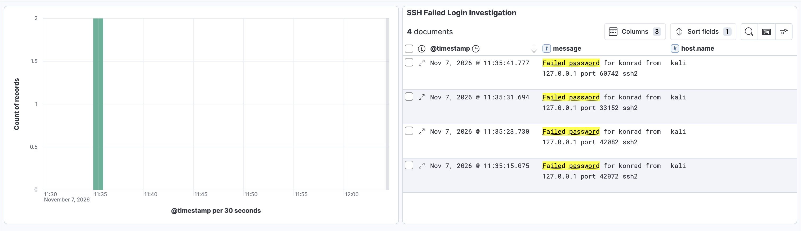

# Elastic Stack SIEM & Log Analysis Lab

## Overview

A hands-on cybersecurity lab focused on centralized Linux log collection, SSH authentication monitoring, and security event investigation using the Elastic Stack.

The project simulates a basic SOC L1 workflow: collecting logs from a monitored Linux endpoint, searching for suspicious authentication activity, and visualizing findings in Kibana.

## Technologies Used

- **Elasticsearch 8.19.24** — Log storage, indexing, and searching.
- **Kibana 8.19.24** — Log investigation, KQL queries, and dashboards.
- **Filebeat 8.19.24** — Collection and forwarding of Linux system logs.
- **Kali Linux** — Monitored Linux endpoint with an SSH server.
- **Docker & Docker Compose** — Deployment of Elasticsearch and Kibana.
- **SSH Tunneling** — Secure transport between Kali Linux and the local Elastic Stack environment.

## Lab Architecture

1. Kali Linux generates SSH authentication events.
2. Filebeat collects events from systemd-journald.
3. Logs are forwarded through an SSH tunnel to Elasticsearch running in Docker on macOS.
4. Kibana provides a centralized interface for searching and analyzing collected events.

**Data flow:** Kali Linux → Filebeat → SSH Tunnel → Elasticsearch → Kibana

## Implementation

### 1. Elastic Stack Deployment

Deployed Elasticsearch and Kibana using Docker Compose with persistent Elasticsearch storage.

### 2. Log Collection

Installed Filebeat on Kali Linux and configured a journald input to collect SSH service logs.

Configured Filebeat to forward events to Elasticsearch through a local SSH tunnel.

### 3. SSH Authentication Simulation

Generated controlled failed SSH authentication attempts against the local Kali Linux SSH service.

### 4. Security Event Investigation

Used Kibana Discover and KQL to identify failed authentication events.

**KQL query:** `message: "Failed password"`

Investigated event timestamps, source IP addresses, targeted accounts, and authentication results.

### 5. Dashboard Creation

Created an SSH authentication monitoring dashboard containing:

- A time-based histogram of failed SSH logins.
- A detailed table of authentication events.
- Host information and event timestamps.

## Investigation Results

- **Detected events:** 4 failed SSH authentication attempts.
- **Target account:** `konrad`
- **Source IP:** `127.0.0.1`
- **Monitored host:** `kali`
- **Observation:** Multiple failed SSH logins within approximately 27 seconds.

The activity was generated intentionally in an isolated laboratory. It demonstrated a brute-force-like authentication pattern, not a confirmed real-world attack.

## Dashboard

## Key Takeaways

- Deploying Elasticsearch and Kibana with Docker.
- Collecting Linux security logs using Filebeat.
- Centralizing and searching events in Elasticsearch.
- Investigating failed SSH authentication attempts using KQL.
- Creating security monitoring visualizations in Kibana.
- Practicing basic SOC L1 log analysis and investigation workflows.

## Security Notes

This is a local educational lab, not a production SIEM deployment. Elasticsearch authentication and TLS were disabled for testing, with access restricted to the local host. Communication from Kali used an SSH tunnel.

Production environments require proper authentication, TLS, access control, and secure network configuration.

