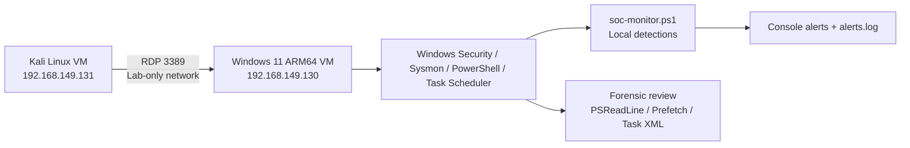
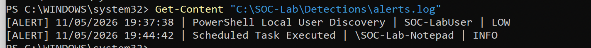
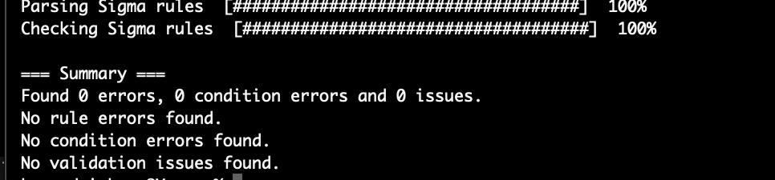
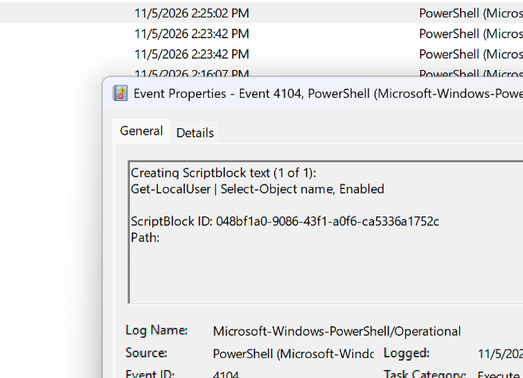
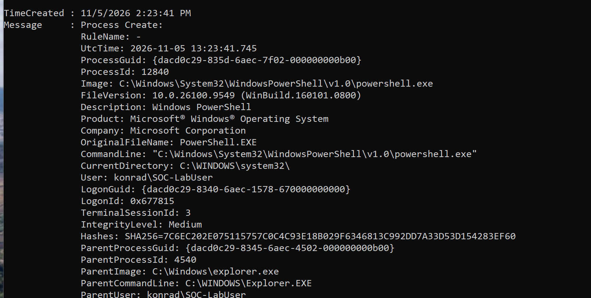
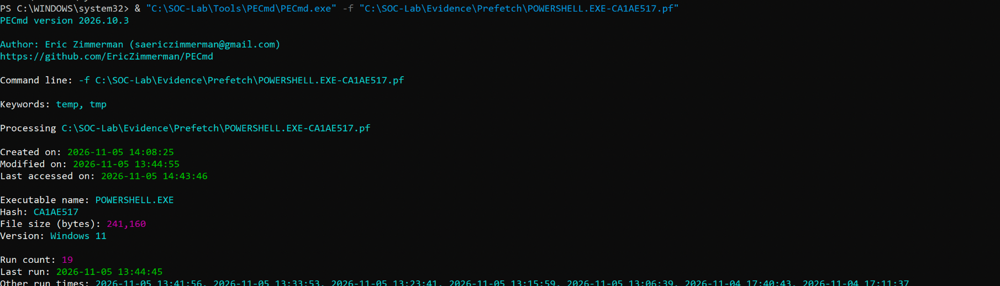

# Windows Endpoint Forensics & SOC Detection Lab

**An authorized Windows security investigation case study** using Kali Linux, Windows 11, Sysmon, PowerShell Script Block Logging, Task Scheduler, Prefetch artifacts, Sigma rules, and a lightweight PowerShell alert monitor.

> **Outcome:** Two laboratory detections produced console alerts and were saved to `alerts.log`; the two lab Sigma rules passed a Sigma CLI 4.0.0 check (**0 errors, 0 condition errors, 0 issues**). This project is an educational simulation, **not a claim of a real compromise** or a production SIEM deployment.

## At a glance

| Area | Result |
| --- | --- |
| Windows telemetry | Security Events 4624/4625, Sysmon Event 1, PowerShell Event 4104, Task Scheduler Event 200 |
| Simulation 1 | Remote logon (RDP), process execution, `Get-LocalUser` discovery |
| Simulation 2 | Authorized scheduled task launches Notepad when the lab user logs on |
| Forensic artifacts | PSReadLine command history, Windows Prefetch, scheduled task XML |
| Detections | 2 Sigma rules + a local PowerShell monitor with 5-second polling |
| Live testing | 2 alerts observed and written to a log |
| Analysis | Correlation using time, user, logon ID, Process ID, parent process and command content |

## Lab architecture



- Host: macOS / VMware Fusion. Guest operating systems: Kali Linux and Windows 11 ARM64.
- Virtual network: **Private to my Mac**; isolated from internet access for lab exercises.
- The IP addresses above are **historical private lab addresses**, not stable configuration requirements.
- Test account: `SOC-LabUser`; administrator's account details are intentionally omitted from this public documentation.

## Scenarios & findings

### 1 — RDP login and local user discovery

An RDP session was initiated from Kali. Windows Security Event **4624** showed a **Type 10** (RemoteInteractive) logon for `SOC-LabUser` on **2026-11-05 14:23:12 CET**, with source `192.168.149.131` and logon ID `0x677815`.

At **14:23:41 CET**, Sysmon Event **1** captured `powershell.exe` (PID `12840`, parent `explorer.exe`, integrity level `Medium`) with the **same** logon ID. PowerShell Event **4104** then recorded `Get-LocalUser | Select-Object name, Enabled` at **14:25:02 CET** with execution process ID `12840`.

The PSReadLine history for the lab user also contained the command. A Prefetch run time of **13:23:41 UTC** for `POWERSHELL.EXE` aligned with the Sysmon creation time **14:23:41 CET**, but Prefetch alone cannot identify the user.

### 2 — Scheduled-task persistence mechanism

An intentionally created task, `\SOC-Lab-Notepad`, was configured with a logon trigger for `SOC-LabUser`, executing `C:\Windows\System32\notepad.exe`. Task Scheduler Event **200** recorded action starts, while Sysmon Event **1** revealed the Notepad process lineage from the `Schedule` service in `svchost.exe`.

The exported XML task definition is described in the [incident report](investigation/incident-report.md). This demonstrates an **execution/persistence mechanism**, not a malicious payload or privilege escalation.

### 3 — Live detection tests (separate test run)

| Recorded time (CET, 2026-11-05) | Alert generated by local monitor | Severity |
| --- | --- | --- |
| 19:37:38 | PowerShell Local User Discovery | LOW |
| 19:44:42 | Scheduled Task Executed (`\SOC-Lab-Notepad`) | INFO |

These evening alerts are from **later validation sessions**; do not assume they represent the exact same RDP session as the earlier 14:23 investigation. Screenshots and a transcribed sample are included below.



## Detection engineering

| File | Data source | Detection logic |
| --- | --- | --- |
| [`detections/win_powershell_local_user_discovery.yml`](detections/win_powershell_local_user_discovery.yml) | Windows PowerShell Script Block Logging (`4104`) | `ScriptBlockText` contains `Get-LocalUser` |
| [`detections/win_scheduled_task_execution.yml`](detections/win_scheduled_task_execution.yml) | Task Scheduler Operational (`200`) | Lab task name and `notepad.exe` action |
| [`scripts/soc-monitor.ps1`](scripts/soc-monitor.ps1) | Local Windows event logs | PowerShell polling and alert file output |

**Sigma is a detection format**. The PowerShell monitor **reimplements the two search conditions**; it does **not** read or execute `.yml` rules, and no SIEM backend was deployed.

Sigma CLI 4.0.0 validation (2026-11-05):

```sh
sigma check "$HOME/Desktop/Detections"
# 0 errors, 0 condition errors, 0 issues
```



See [detection testing](docs/detection-testing.md) for deployment and limitations.

## Investigation report & evidence

- [**SOC incident investigation report**](investigation/incident-report.md) — alert triage, evidence, classification, findings, and recommendations.
- [**Timeline**](investigation/incident-timeline.md) — exact recorded times, sources, and notes on confidence.
- [**Evidence guide**](evidence/README.md) — screenshot index and what was / was not acquired.
- [**Lab procedure**](docs/lab-procedure.md) — minimum reproducible workflow.

## Selected evidence

| Evidence | Screenshot |
| --- | --- |
| PowerShell script-block content |  |
| Sysmon PowerShell process context |  |
| Parsed PowerShell Prefetch |  |

## Results & lessons learned

- Correctly correlated a remote logon, child process, and PowerShell script block using **Logon ID** and **PID**.
- Demonstrated a scheduled task logon trigger and validated its action against Task Scheduler + Sysmon records.
- Recovered historical execution information from **Prefetch**, while respecting its attribution limits.
- Built and tested two simple local alert conditions, then validated Sigma rule syntax and structure.
- Distinguished **a detected behavior** from **an actual security incident**: all activities were authorized lab tests.

## Limitations and next steps

- No production SIEM, centralized ingestion, Sigma backend conversion, or automated alert orchestration.
- Polling monitor is best-effort (5-second loop, latest 200 events per log): it can miss events at high volume, after restart, or if log records roll over.
- Rule matching is narrow and can have legitimate administrative false positives; the second rule explicitly matches only our lab task.
- No original `.evtx` export or formal chain-of-custody acquisition was preserved in this repository. Screenshots and copied outputs are **illustrative evidence**, not forensically verified source records.
- To improve: expand parent-child process telemetry and creation/change event detection, create negative tests, test backend mapping, and forward logs to a SIEM.

> **Safety / privacy:** Perform only in your own isolated VM lab. Do not expose RDP to public networks. Check screenshots and exported logs for identifiable data and secrets before publishing.

## References

- [SigmaHQ rule format](https://sigmahq.io/docs/basics/rules.html)
- [SigmaHQ log sources](https://sigmahq.io/docs/basics/log-sources.html)
- [Microsoft Sysmon](https://learn.microsoft.com/en-us/sysinternals/downloads/sysmon)
- [MITRE ATT&CK T1087.001 — Local Account Discovery](https://attack.mitre.org/techniques/T1087/001/)
- [MITRE ATT&CK T1053.005 — Scheduled Task](https://attack.mitre.org/techniques/T1053/005/)
